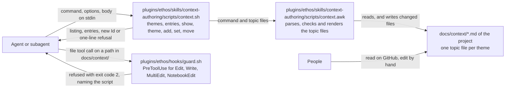
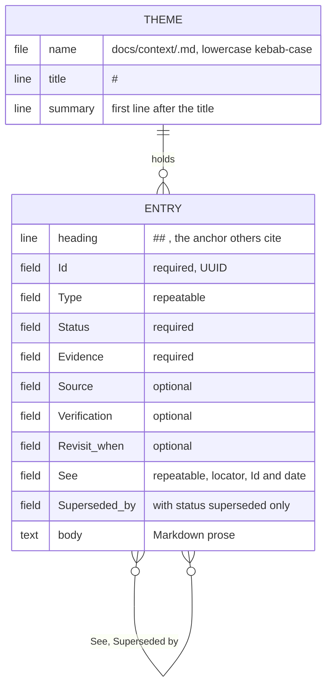

# Context directory

The project is the Git toplevel of the working directory, or the working directory outside Git.
`theme` creates `docs/context/` with its first topic file, and `move` deletes a topic file whose last entry it moves out.
After every write the script points every `See` line of the project at the cited entry's current file and heading.

## Topic file

Each field is one `**<Field>:** <value>` line below the heading, in the order above; the values each field accepts are in `context.awk`.
