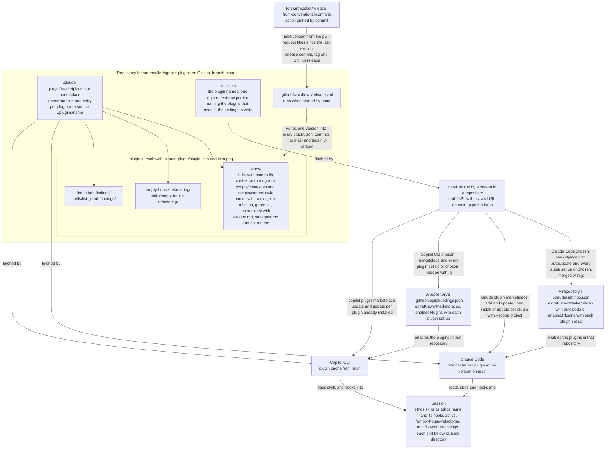

# Distribution

A repository enables any combination of the three plugins, and a plugin's cache holds only its own folder under `plugins/`.

Claude Code moves a plugin's cache to `main` only when the version in its `plugin.json` differs from the cached one, and runs that update by itself because of `autoUpdate` on the marketplace entry: in the background, up to ten minutes after a session's first message, applied from the next start or `/reload-plugins`, while the installer runs it at once.
Copilot CLI ignores `autoUpdate` in a repository's settings, so it updates a plugin on `copilot plugin update`, which the installer runs, unless the person's own settings mark the marketplace `autoUpdate`.

Both tools put a skill's base directory, its folder in the plugin cache, above the skill's text, and the agent starts the skill's scripts from there through `sh`, with the repository as working directory.

Claude Code downloads a plugin that a repository enables only after one install per clone, which the installer runs, while Copilot CLI installs it once the folder is trusted.
The installer runs at the Git toplevel, asks about each plugin not yet set up for the chosen tool, updates each one already set up, lists only the requirements of those plugins, and fetches nothing beyond itself; [the README](../../README.md#installation) gives the one-liner.
