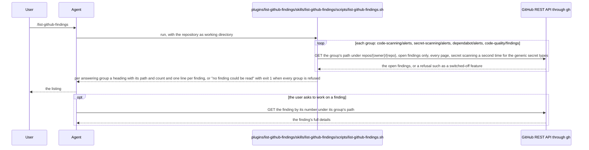

# List GitHub findings

[`SKILL.md`](../../plugins/list-github-findings/skills/list-github-findings/SKILL.md) holds the rules, and [`docs/context/list-github-findings.md`](../context/list-github-findings.md) the reasons.
