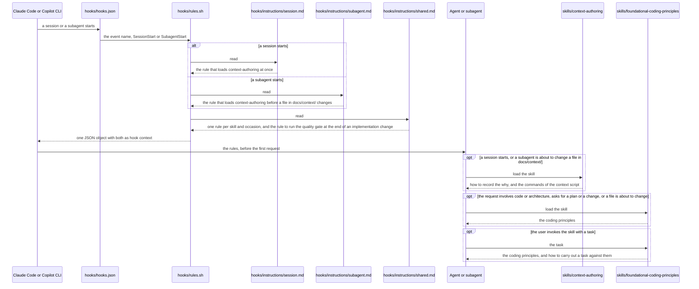

# Session start

A session and a subagent receive the same shared list, and each its own rule for `context-authoring`: a session loads it at once, a subagent before it changes a file in `docs/context/`.
The session start creates nothing in the project.

[The context directory](./context.md) shows how the agent then reads and writes `docs/context/`.

The JSON object carries the rules twice, in the top-level `additionalContext` that Copilot CLI reads and in `hookSpecificOutput.additionalContext` that Claude Code reads.

Copilot CLI starts its `general-purpose` subagent without a hook, so that subagent knows the rules only through what the main agent passes on.

## Instruction files of a repository

A repository's own `AGENTS.md` or `CLAUDE.md` files reach the agent through the tool itself, beside the plugin.
