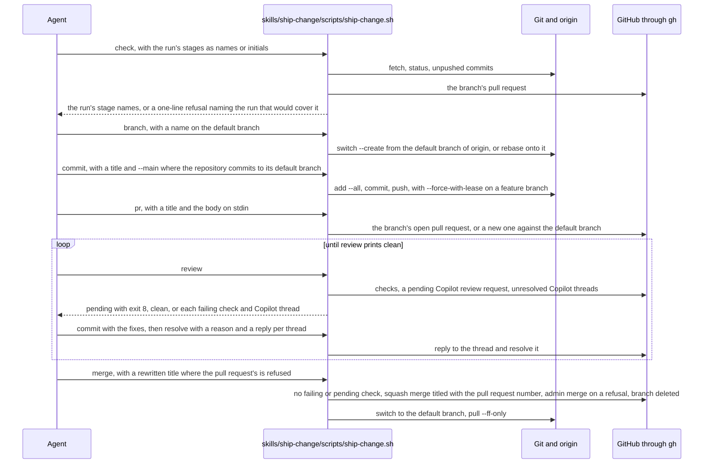

# Ship change

The agent reads the stages from `/ship-change` or the user's words, and `state` gives it the facts behind its judgements, such as whether a branch is meant for the changes; [`SKILL.md`](../../skills/ship-change/SKILL.md) holds the rules, and [`docs/context/ship-change.md`](../context/ship-change.md) the reasons.
